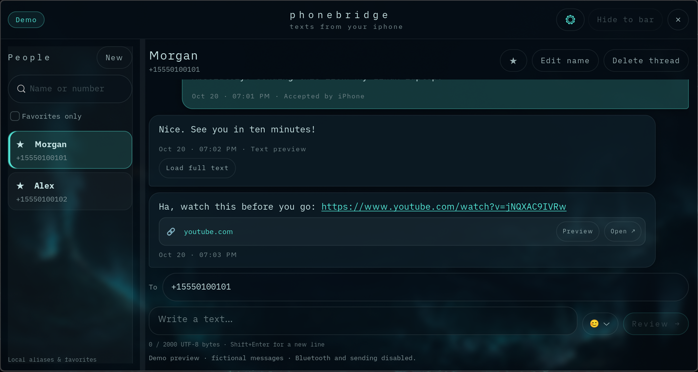

# PhoneBridge

Text from a Linux desktop through a nearby iPhone over Bluetooth. No awake Mac, Apple sign-in on Linux, or cloud relay.

**Experimental alpha.** It works every day on one setup (below), and has not yet been tried on a second phone or laptop. Expect some Bluetooth setup; the guided `phonebridge-setup` handles the usual iPhone permission snag. Reports from other setups are very welcome. This is not an official Apple or Omarchy product.



## Tested on

- iPhone on iOS 26.7.3, paired with a ThinkPad T14 Gen 1 (built-in Intel Bluetooth)
- Omarchy (Arch Linux, Hyprland), BlueZ and bluez-obex 5.87
- Python 3, GTK 4

On that iPhone, **Show Message Notifications** didn't appear in the Bluetooth settings until PhoneBridge's temporary accessory signal ran (step 3 under First connection). After that it stayed on.

## Desktop client

- A compact two-column chat with people on the left and messages/composition on the right.
- A Settings gear for phone connection, notifications, sound and window modes.
- Optional standard status-bar/tray icon with connection state and local unread counts.
- Incoming texts with full-body loading for the selected person, plus texts sent during the current app session.
- Wrapped message bubbles, stable history scrolling, and Jump to latest when reading older texts.
- Favorite senders, editable local aliases, and a Favorites-only filter.
- One-recipient composition with an exact review before every send.
- Saved Notifications and Sound switches, generic private alerts, and a short bundled ding with Test ding.
- Explicit accepted/uncertain send states, no automatic resend.
- A temporary accessory signal helper for missing iPhone permission controls.

## Install and run

Requires Linux, a suitable Bluetooth adapter, BlueZ and its OBEX service, Python, dbus-python, PyGObject, and GTK 4. On Omarchy/Arch:

```sh
omarchy pkg add bluez bluez-utils bluez-obex python-dbus python-gobject gtk4
python scripts/install.py
```

Run `phonebridge`, find PhoneBridge in the app launcher, or open it from the Omarchy menu (Super + Alt + Space). The installer is per-user and does not enable a background service or change Bluetooth settings. On other Linux desktops it adds a standard desktop entry. Preview without Bluetooth, persistent settings or sending:

```sh
python app.py --demo
```

The current installer does not remove obsolete application files during upgrades. To uninstall, remove `~/.local/bin/phonebridge` and `~/.local/bin/phonebridge-setup`, the `phonebridge/app` subfolder under your XDG data directory, the desktop entry `io.phonebridge.Desktop.desktop`, the `phonebridge.svg` icon, and the `kirk.phonebridge` menu entry if present. Preserve `cleared.json`, `favorites.json`, `aliases.json` and `preferences.json` unless you intend to delete your local names and settings.

## First connection

Follow the step-by-step [How-To guide](HOW-TO.md), or run `phonebridge-setup` for guided pairing, permission setup and a message-free access check. From source use `python connect_phone.py`. The Settings gear → **Pair / setup…** button opens the same guide. Returning users with a working bond normally just Connect.

1. Pair your iPhone and computer using Bluetooth settings, confirming matching codes on both devices.
2. On iPhone, open Settings → Bluetooth → the information button beside the computer, and enable Show Message Notifications if available.
3. If the switch is absent, open the Settings gear and click **Pair / setup…**. Select the phone's list number in the terminal. While the temporary signal is active, leave and reopen the iPhone's computer detail page. On our initial setup this exposed the switch without re-pairing.
4. Select the phone and Connect. Incoming senders appear in People. Choose one or use New text. Favorite saves the selected address locally. Edit name assigns or clears a local alias without changing the recipient address.
5. Review the recipient and text before Send text. A text from a group does not identify its other participants; selecting it targets that sender only.

The accessory helper broadcasts a temporary Bluetooth advertisement for at most 90 seconds. It does not read notifications, send messages or modify adapter identity. Other phones/iOS versions may need different setup. The new connection wizard orchestrates pairing, the temporary signal and a final access check; clean first-time wizard testing is still pending.

## Limits you should know

This is a text client with limited history, not a complete Apple Messages replica:

- Inbox discovery is limited to the latest 100 previews, up to 255 characters each. Selecting a person requests complete text bodies separately, without attachments, using private temporary files that are removed afterward. Downloads are limited to 2 MiB per bMessage. Until loading succeeds, or if it fails, the bubble is explicitly labeled as a preview and offers a retry. Full-body interoperability on the phone still needs a live check after this update.
- Existing chat rows are updated in place. Empty polls do not redraw or move the chat. New texts follow the bottom only when you are already near it; use Jump to latest after reading older history.
- Sending currently supports one recipient and up to 2,000 UTF-8 bytes (Shift+Enter adds a line break). No group replies, reactions, media or calls. Photos and videos are not available over the iPhone's Bluetooth message service (the attachment probe returned text only). Links are clickable; Preview fetches a page title and thumbnail only when you click it.
- The iPhone decides iMessage versus SMS. Bluetooth MAP's `SMS_GSM` label does not identify the actual service. Carrier charges depend on your phone plan.
- Bluetooth transfer acceptance does not establish recipient delivery. If a receipt is uncertain, check the phone before acknowledging and composing again. The client never resends automatically.
- Messages you send from the phone may not appear here. Outgoing history is limited to sends made during the app session.
- With **Live in status bar** enabled and a registered tray host, closing X or Hide to bar hides the chat while reception and notifications continue. Open it through the tray or launcher. **Settings → Quit PhoneBridge** (or the tray menu) closes the Bluetooth worker and exits; that clears session texts/unread counts. Without an available tray host, closing exits normally.
- Compact floating mode brings the main window to the current Hyprland workspace; turn it off for a normal tiled workspace window. Other desktops keep their normal compositor placement. PhoneBridge does not edit Hyprland configuration.
- No automatic reconnect, login startup or persistent chat database is implemented. Start the app manually and connect once each app session.
- No permanent Bluetooth changes or phone reset are part of installation. Prefer resolving permissions before unpairing.

## Privacy

Message bodies, outgoing recipients, and send receipts stay in process memory, apart from private temporary bMessage files used for sending and full-text downloads and removed afterward. The iPhone and recipients retain their normal copies. Terminal test tools print private data locally; don't post their output or real-message screenshots publicly.

Favorites are saved through the Favorite action in `$XDG_DATA_HOME/phonebridge/favorites.json` (normally `~/.local/share/phonebridge/favorites.json`), with owner-only file and directory permissions. Aliases saved through Edit name live in `aliases.json`, and notification/sound choices in `preferences.json` in the same owner-only directory. These files are not encrypted. Notifications are optional and generic. The notification daemon is asked to suppress its own sound; PhoneBridge plays its bundled ding only when both Notifications and Sound are enabled. A system mute or an unavailable audio backend may prevent audible playback. Audio uses PipeWire `pw-play`, PulseAudio `paplay`, or `canberra-gtk-play` if available; message text is never passed to audio commands. Capability reports contain no names, device addresses or message content. There is no network listener, analytics or external account connection.

The desktop uses one Bluetooth worker to serialize connect, receive and send. GTK handles controls and receives completion events. Hiding is allowed during a send; Quit waits for its result before stopping the worker. Shutdown waits for Bluetooth cleanup, including temporary download files. Local unread counts never write the iPhone Read flag. Unknown transfer objects alone are never treated as success.

## Validation and sharing

```sh
python -m unittest discover -s tests -v
python -m compileall -q app.py bridge.py model.py phonebridge.py send_test.py receive_test.py request_access.py
```

See [test plan](docs/TESTING.md), [release checklist](docs/RELEASE.md), and [protocol references](docs/REFERENCES.md). The current source is locally versioned; no public repository or marketplace submission has been created.

MIT license covers this project's original code. No implementation source from another bridge has been incorporated. BlueZ, GTK, dbus-python and PyGObject are separate runtime dependencies with their own licenses.

## Status-bar mode

The **Live in status bar** and **Compact floating window** choices are saved in Settings and default on. The status icon uses the standard StatusNotifierItem/DBusMenu protocols already supported by Omarchy's system tray; it is not a native Omarchy shell plugin. Depending on tray configuration it may be behind the tray expansion arrow.

- Click the icon to bring up the chat on your current workspace; click again while active to hide it.
- Right-click/menu actions expose Open/Hide, Settings and Quit PhoneBridge.
- The badge counts new, locally unread messages while hidden or viewing another person. Initial inbox history is not counted. Viewing the selected person's latest text clears their local badge; no iPhone read flag changes.
- If the tray host disappears, a hidden window is shown so the app remains reachable; registration is retried when the host returns.
- If no tray is supported, the app remains a normal usable window and does not hide on close. The launcher always reopens a hidden running app.

Tray registration, host restart, actual window placement and the revised compact UI still need live desktop acceptance. Automated tests validate state transitions, protocol marshalling, original icon pixels and dispatch targeting, not a running tray host.

### Emoji in your texts

Click **😊** beside the message box to choose a heart, smile or reaction. It inserts at the cursor or replaces selected text. Emoji count toward the 2,000 UTF-8 byte limit; shorten the draft if insertion would exceed it. Use **Review →** to send as usual.

### Conversation order and deletion

People and Favorites show conversations with the newest message first; contacts without messages follow alphabetically. Select a conversation and click **Delete thread** to clear its current history from PhoneBridge after confirmation. Your iPhone messages, aliases and favorites remain. Cleared favorites are hidden until a new text arrives. New messages restore the conversation at the top. Messages arriving while the confirmation is open are kept. Deletion is disabled during pending or uncertain sends.

Deletion markers persist as hashes of message identities and contact keys in the private `cleared.json` file beside your local settings; message bodies are not saved. These hashes are not encryption. Removing that file allows old iPhone inbox entries to reappear on reconnect. There is no in-app undo.

### Keyboard sending

With the cursor in the message box, press **Enter** to review the exact recipient and draft. Press **Enter again** in the review window to send once. **Escape** returns to editing. After an accepted send, focus returns to the message box. Invalid drafts, disconnected state, pending sends and uncertain outcomes keep their existing safeguards.

## Credit

Made by Kirk Fuson ([EchoLine](https://echoline.digital)). MIT licensed; see [LICENSE](LICENSE). Fonts: Monoton and Orbitron (SIL Open Font License, see `assets/fonts`).
